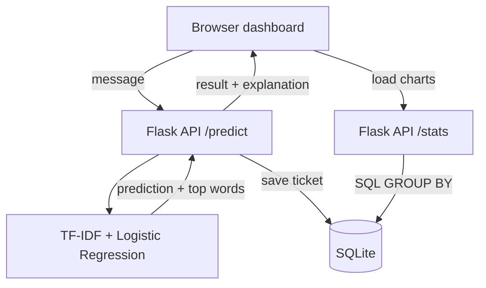

<div align="center">

# 🎫 Support Ticket Classifier

**An NLP web app that sorts customer support messages into the right team, and shows you why.**


</div>

<p align="center">
  <a href="#-what-is-this">About</a> ·
  <a href="#-features">Features</a> ·
  <a href="#-screenshots">Screenshots</a> ·
  <a href="#%EF%B8%8F-how-it-works">How it works</a> ·
  <a href="#-results">Results</a> ·
  <a href="#-getting-started">Get started</a> ·
  <a href="#%EF%B8%8F-tech-stack">Tech stack</a>
</p>

---

## 📌 What is this?

Companies get hundreds of customer messages every day, such as *"I was charged twice"*, *"My package never arrived"*, or *"I forgot my password"*. Someone has to read each one and decide which team should handle it.

This project does that sorting automatically. You paste a message, and the app tells you the category, how confident it is, and **which words influenced the decision**. Every ticket is saved to a database and shown on a live dashboard.

## ✨ Features

| Feature | Description |
|---|---|
| 🧠 **NLP classification** | TF-IDF text features with a Logistic Regression model, trained on 11 customer support categories |
| 📊 **Confidence score** | Every prediction comes with a probability, so you know how sure the model is |
| 🙋 **Human review fallback** | If confidence is under 50%, the ticket is labeled *Needs review* instead of guessing |
| 🔍 **Explainable predictions** | A "How the model decided" box shows the top 3 guesses and the words that pushed the result |
| 🗄️ **SQL analytics** | Tickets are stored in SQLite, and the dashboard uses `GROUP BY` queries for category counts |
| 🌐 **REST API** | Flask endpoints `/predict` and `/stats` that the dashboard calls |
| ✅ **Automated tests** | pytest checks the API, including empty-input handling |

## 🖼️ Screenshots

### Dashboard

<p align="center">
  
0%">
</p>
<p align="center"><em>Classify a message, then watch the dashboard fill up: tickets are saved to SQLite and counted with SQL <code>GROUP BY</code>.</em></p>

### Predictions with explanations

<table>
  <tr>
    <td width="33%"></td>
    <td width="33%"></td>
    <td width="33%"></td>
  </tr>
  <tr>
    <td align="center"><sub>Result with confidence score</sub></td>
    <td align="center"><sub>Top 3 guesses and probability bars</sub></td>
    <td align="center"><sub>Words that influenced the decision</sub></td>
  </tr>
</table>

---

## 🗂️ Categories

`Account` · `Cancel` · `Contact` · `Delivery` · `Feedback` · `Invoice` · `Order` · `Payment` · `Refund` · `Shipping` · `Subscription`

## 🏗️ How it works



**Training pipeline** (`train_model.py`):

1. Load the dataset and remove duplicate messages, so the test set doesn't overlap with training data
2. Split 80% for training and 20% for testing, keeping every category balanced
3. Convert text to numbers with TF-IDF (single words and word pairs)
4. Train a Logistic Regression classifier
5. Measure accuracy on messages the model has never seen
6. Save the trained model to `model.joblib`

## 📈 Results

| Metric | Value |
|---|---|
| Dataset | Bitext Customer Support (26,872 rows) |
| Unique messages after removing duplicates | 24,635 |
| Categories | 11 |
| Test messages (unseen) | 4,927 |
| **Test accuracy** | **99.65%** |

> **Honest note:** the Bitext dataset is template-generated, so its sentences are very regular. Accuracy on real, messy customer messages would likely be lower. That is why the app routes low-confidence tickets to human review.

## 🚀 Getting started

**1. Clone the repository**

```bash
git clone https://github.com/nihaltiwari01/support-ticket-classifier.git
cd support-ticket-classifier
```

**2. Install the libraries**

```bash
pip install -r requirements.txt
```

**3. Get the dataset**

Download the *Bitext Customer Support* dataset from Kaggle and save the CSV as `data/bitext.csv`. It needs the columns `instruction` and `category`.

**4. Train the model**

```bash
python train_model.py
```

**5. Run the app**

```bash
python app.py
```

Open **http://127.0.0.1:5000** in your browser.

## 🧪 Run the tests

```bash
python -m pytest
```

## 🔬 See how the model thinks

```bash
python explain_model.py
```

Type any message, and the script prints the words the model recognized, the probability for each category, and which words pushed the decision.

## 📁 Project structure

```
support-ticket-classifier/
├── app.py              # Flask API, prediction logic, SQLite storage
├── train_model.py      # Trains and saves the NLP model
├── explain_model.py    # Command-line tool to inspect predictions
├── requirements.txt    # Python dependencies
├── templates/
│   └── index.html      # Dashboard (HTML, CSS, JavaScript)
├── tests/
│   └── test_app.py     # pytest tests for the API
└── data/
    └── bitext.csv      # Dataset (download separately)
```

## 🛠️ Tech stack

| Area | Tools |
|---|---|
| Language | Python, JavaScript |
| Machine learning | scikit-learn (TF-IDF, Logistic Regression) |
| Backend | Flask |
| Database | SQLite, SQL |
| Frontend | HTML, CSS, vanilla JavaScript |
| Testing | pytest |

## 🔮 Future improvements

- [ ] Train on a real-world, human-written support dataset
- [ ] Try stronger language models such as BERT embeddings
- [ ] Let reviewers correct labels and retrain on the corrections (feedback loop)
- [ ] Move from SQLite to PostgreSQL for many users
- [ ] Containerize with Docker and deploy to the cloud

## 👤 Author

**Nihal Tiwari**, MCA student at NIT Meghalaya

[LinkedIn](https://linkedin.com/in/nihaltiwari) · [GitHub](https://github.com/nihaltiwari01)

---

<div align="center">

If you found this project useful, consider giving it a ⭐

</div>
